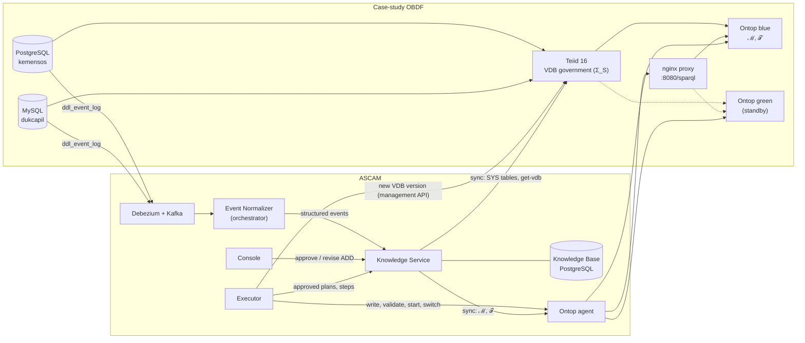

# ASCAM: Adaptive Schema-Change Awareness and Mapping Maintenance

ASCAM keeps an ontology-based data federation (OBDF) working when the schema of one of its
sources changes. It watches the sources for `ALTER TABLE ... ADD`, `DROP`, and `RENAME COLUMN`,
works out which parts of the federated schema, the R2RML mapping, and the ontology depend on the
changed column, and then either adapts them automatically, asks the administrator to approve the
change (new columns), or reports what a person has to repair. Adaptations are deployed side by
side with the running version and switched over only after they have been verified, so SPARQL
queries keep being answered while ASCAM works.

This repository holds the whole laboratory of the thesis: a case-study OBDF for social
assistance data (PostgreSQL and MySQL federated by Teiid and exposed as SPARQL by Ontop), the
ASCAM services, and the evaluation harness.

- [Architecture](#architecture)
- [Requirements](#requirements)
- [Setup and running](#setup-and-running)
- [Running the experiments](#running-the-experiments)
- [Knowledge Base and ERD](#knowledge-base-and-erd)
- [Tests](#tests)
- [Repository layout](#repository-layout)
- [Documentation](#documentation)

## Architecture



ASCAM follows the MAPE-K loop of autonomic computing:

| Phase | Component | What it does |
|---|---|---|
| Monitor | Schema monitors in the sources, Debezium, Kafka, Event Normalizer | Each source records `ALTER TABLE` column changes in a log table (`ddl_event_log`): an event trigger in PostgreSQL, a 10-second polling job in MySQL. Debezium streams only that log table to Kafka. The Event Normalizer (`setup/ascam/orchestrator`) parses the DDL and sends one structured event per column change to Knowledge |
| Analyze, Plan | Knowledge Service | Resolves the event against the active specification version, follows the column lineage (source column → Teiid column → views → R2RML term maps → ontology property), and applies the decision matrix: `auto`, `hitl` (ADD only), or `notify` (DROP or RENAME that is not provably safe). It stores a plan with its actions on the VDB, the mapping, and the ontology |
| Execute | Executor and Ontop agent | Deploys the changed federated schema Σ′_S as a new Teiid VDB version, writes ℳ′ and 𝒯′ into the standby Ontop slot, validates them, starts the standby instance, verifies its answers, switches the proxy, and syncs Knowledge. A failure before the switch leaves the running version untouched |
| Knowledge | Knowledge Base | Versioned snapshots of Σ_S, ℳ, and 𝒯, their dependency graph and column lineage, and the trail of events, plans, executions, notifications, and audit records |

The three adaptation patterns:

| Pattern | Operation | What ASCAM does |
|---|---|---|
| P-001 | ADD COLUMN | Waits for the administrator. On approval: `ALTER FOREIGN TABLE ... ADD COLUMN`, a new `owl:DatatypeProperty`, and a predicate-object map on the TriplesMaps that pick up the column |
| P-002 | DROP COLUMN | When every usage is a plain value or projection: `DROP COLUMN`, `ALTER VIEW` for views that pass the column on, removal of the predicate-object maps, and `owl:deprecated` on the property. Otherwise a notification |
| P-003 | RENAME COLUMN | `ALTER COLUMN ... OPTIONS (SET NAMEINSOURCE '<new name>')`: the Teiid column keeps its name, so views, the mapping, and the ontology do not change |

### Containers and ports

| Container | Component | Host port |
|---|---|---|
| `datasources-pgsql` | PostgreSQL 15, database `kemensos` | 15433 |
| `datasources-mysql` | MySQL 8.0, database `dukcapil` | 13306 |
| `data-federation-teiid` | Teiid 16 on WildFly: JDBC, ODBC, management API, HTTP | 31000, 35432, 19990, 18080 |
| `vkg-system-ontop-teiid` | nginx proxy in front of Ontop, the SPARQL endpoint | 8080 |
| `vkg-system-ontop-blue`, `vkg-system-ontop-green` | Ontop 4.1.1 instances (one runs at a time) | – |
| `ascam-sm-zookeeper`, `ascam-sm-kafka` | ZooKeeper and Kafka | 2181, 29092 |
| `ascam-sm-connector` | Kafka Connect with the Debezium connectors | 8083 |
| `ascam-sm-kafka-ui` | Kafka UI | 8081 |
| `ascam-knowledge-db` | Knowledge Base (PostgreSQL 16) | 55432 |
| `ascam-knowledge-migrate` | Runs the Alembic migrations once, then exits | – |
| `ascam-knowledge-service` | Knowledge Service API | 18000 |
| `ascam-ontop-agent` | Ontop agent | 18100 (localhost) |
| `ascam-orchestrator` | Event Normalizer | 18200 (localhost) |
| `ascam-executor` | Executor | 18300 (localhost) |
| `ascam-ui` | Administrator console | 18400 |

All containers share the external Docker network `ascam-networks`. Every component of
`setup/` has its own `docker-compose.yaml` and README.

## Requirements

- Docker Engine with `docker-compose` (the scripts also accept the `docker compose` plugin).
- `git`, `curl`, and Python 3.10 or later on the host (the scripts and the harness use only the
  standard library; `plot.py` also needs matplotlib).
- Internet access the first time, to pull images and to build the Teiid and ASCAM images
  (Docker Hub, quay.io, Maven Central, PyPI).
- The host ports listed above must be free. The lab creates 17 containers (the migration
  container exits after its run, and one Ontop instance stays stopped until an adaptation); give
  Docker enough memory for two Ontop JVMs, Teiid, and Kafka.

## Setup and running

```bash
git clone https://github.com/rahilaode/data-federation-dev.git
cd data-federation-dev
./start.sh
```

`start.sh` builds the lab from scratch, in dependency order: it creates the secrets
(`setup/ascam/knowledge/secrets/`, not committed), takes every container down **with its volumes**,
restores the mapping and the ontology from git, starts the sources (rebuilt from `init.sql`),
Teiid, the blue-green Ontop layer, Kafka and Debezium (and registers the connectors), the
Knowledge Service, the Ontop agent, the Event Normalizer, the Executor, and the console, then runs
an initial sync and the preflight checks, including a real DDL that travels through the whole
event chain.

When it is done:

| What | Where |
|---|---|
| Administrator console | <http://127.0.0.1:18400>, user `admin`, password in `setup/ascam/knowledge/secrets/ui_admin_password` |
| SPARQL endpoint | <http://localhost:8080/sparql> |
| Knowledge Service API | <http://127.0.0.1:18000/docs> (token: `grep '^ui:' setup/ascam/knowledge/secrets/knowledge_api_tokens`) |
| Kafka UI | <http://localhost:8081> |

A first query:

```bash
curl -s -G http://localhost:8080/sparql -H 'Accept: application/sparql-results+json' \
  --data-urlencode 'query=PREFIX bansos: <http://bansos.go.id/ontology/>
SELECT ?p ?nama WHERE { ?p a bansos:ProgramBansos ; bansos:namaProgram ?nama } ORDER BY ?p'
```

Three scripts cover day-to-day use:

| Script | When | What it resets |
|---|---|---|
| `./start.sh` | First run, or to rebuild everything | **Everything**, source data and Kafka topics included |
| `./restart-ascam.sh` | Day to day, and before an experiment | **ASCAM only**: the Knowledge database is recreated and synced from the running OBDF; the OBDF, the source data, and Kafka are left as they are |
| `./stop.sh` | To stop the lab | Nothing (`./stop.sh --volumes` also deletes the volumes) |

`restart-ascam.sh --chain-test` adds the end-to-end event chain test, and
`restart-ascam.sh --executor-paused` starts the Executor paused.

### Trying a schema change by hand

Rename a column that the mapping uses (scenario A003), then watch the console
(Schema changes, Plans and executions):

```bash
docker exec datasources-pgsql psql -U postgres -d kemensos -c 'ALTER TABLE public.program_bansos RENAME COLUMN nama_program TO judul_program'
```

ASCAM decides `auto`, deploys a new VDB version with `SET NAMEINSOURCE 'judul_program'`, starts
and verifies the standby Ontop instance, and switches to it; the query above keeps returning the
same answers. An `ADD COLUMN`, for example
`ALTER TABLE public.penerima_manfaat ADD COLUMN email VARCHAR(100)`, appears under Approvals,
where the proposed property can be approved or renamed. Renaming the column back is adapted the
same way; `./start.sh` returns the whole lab to its base state.

## Running the experiments

The evaluation applies nine schema changes, each in two modes: **baseline** (Executor paused,
no adaptation; 5 runs per scenario) and **treatment** (the full ASCAM loop; 20 runs per scenario).
For every run it records the answers of five SPARQL queries before and after the change, the
decision, the time of every step, the availability of the endpoint during the adaptation, and it
audits every Kafka message to show that no production data leaves the sources. The full protocol,
the metrics, and the threats to validity are in [`docs/evaluation.md`](docs/evaluation.md).

```bash
./start.sh                                                     # clean lab
python3 experiments/evaluation/self_test.py                    # harness self-test (no Docker)
python3 experiments/evaluation/evaluate.py --mode both --runs 1 --baseline-runs 1   # short trial
nohup python3 experiments/evaluation/evaluate.py --mode both --runs 20 --baseline-runs 5 \
  > evaluation.log 2>&1 &                                       # full evaluation, several hours
tail -f evaluation.log
```

The results go to `results/evaluation/<time>/` (one JSON file per run, the Kafka audit, the
Debezium configuration, and `metadata.json` with the commit, the random-delay seed, and the
machine). Then:

```bash
python3 experiments/evaluation/analyze.py results/evaluation/<time> > results/evaluation/<time>/analysis.md
python3 experiments/evaluation/extract.py results/evaluation/<time>     # CSV and summary.json
python3 experiments/evaluation/plot.py results/evaluation/<time>        # adaptation-time figure (matplotlib)
```

`./run-evaluation.sh` does all of this in one go, starting with `./start.sh`.

The evaluation refuses to run when tracked files differ from the current commit, so that every
result names the code that produced it. Results of the earlier Indonesian-language harness
(`results/f6/`, branch `eval/final`) can be converted with
`experiments/evaluation/convert_results.py` and then analysed the same way.

### Schema changes (ALTER TABLE)

| Scenario | Source | Statement applied to the source |
|---|---|---|
| A001 | PostgreSQL (kemensos) | `ALTER TABLE public.penerima_manfaat ADD COLUMN email VARCHAR(100)` |
| A002 | PostgreSQL (kemensos) | `ALTER TABLE public.program_bansos DROP COLUMN tipe_program` |
| A003 | PostgreSQL (kemensos) | `ALTER TABLE public.program_bansos RENAME COLUMN nama_program TO judul_program` |
| A004 | MySQL (dukcapil) | `ALTER TABLE master_wilayah ADD COLUMN kode_pos VARCHAR(10)` |
| A005 | MySQL (dukcapil) | `ALTER TABLE master_penduduk DROP COLUMN status_hidup` |
| A006 | MySQL (dukcapil) | `ALTER TABLE master_penduduk RENAME COLUMN tanggal_lahir TO tgl_lahir_ktp` |
| A007 | PostgreSQL (kemensos) | `ALTER TABLE public.penerima_manfaat DROP COLUMN no_kartu_keluarga` |
| A008 | MySQL (dukcapil) | `ALTER TABLE riwayat_perubahan_data DROP COLUMN diubah_oleh` |
| A009 | PostgreSQL (kemensos) | `ALTER TABLE public.program_bansos DROP COLUMN periode_selesai` |

Before a DROP the harness copies the column into a backup table (`ascam_backup_<column>`); after
each run it puts the column back and waits for the monitor to report the restore. A001 and A004
fill three rows of the new column after the change. Every statement, including the backup,
data, and restore statements, is listed per scenario in
[`docs/evaluation.md`](docs/evaluation.md#statements-applied-to-the-sources).

Expected outcome per scenario:

| Paper | Change | Expected decision | Expected answers after the adaptation |
|---|---|---|---|
| A001, A004 | ADD | `hitl`, approved by the evaluator | Old queries still run; the query on the new property returns the filled rows |
| A002, A005 | DROP of a plain column | `auto` | The predicate disappears; its query still runs and returns an empty answer set; the other queries still run |
| A003, A006 | RENAME | `auto` | All answers identical |
| A007, A008 | DROP of a column read through a view | `auto` (`ALTER VIEW`) | As for DROP |
| A009 | DROP of a column used in a view expression | `notify`, no actions | Not adapted: the affected query fails, as without ASCAM, until a person repairs the view |

### SPARQL queries

Every scenario runs five queries, before and after the change: q1 reads the changed column
(affected), q2 another column of the same table or view (neighbour), and q3–q5 other tables
(control). q4 `count_per_class` and q5 `transaction_status` are the same in every scenario. The
queries are listed exactly as they are sent to `http://localhost:8080/sparql`; they are defined in
`experiments/evaluation/queries.py` and also listed in
[`docs/evaluation.md`](docs/evaluation.md#sparql-queries).

- **A001**: ADD COLUMN email on penerima_manfaat (PostgreSQL)
  - q1 `email` (affected)

    ```sparql
    PREFIX bansos: <http://bansos.go.id/ontology/>
    SELECT ?p ?email WHERE { ?p bansos:email ?email } ORDER BY ?p
    ```

  - q2 `recipient` (neighbour)

    ```sparql
    PREFIX bansos: <http://bansos.go.id/ontology/>
    SELECT ?p ?nama ?status WHERE { ?p a bansos:PenerimaBansos ; bansos:namaLengkap ?nama ; bansos:statusEkonomi ?status } ORDER BY ?p
    ```

  - q3 `resident_link` (control)

    ```sparql
    PREFIX bansos: <http://bansos.go.id/ontology/>
    SELECT ?p ?d WHERE { ?p bansos:memilikDataKependudukan ?d } ORDER BY ?p
    ```

  - q4 `count_per_class` (control)

    ```sparql
    PREFIX bansos: <http://bansos.go.id/ontology/>
    SELECT ?kelas (COUNT(?s) AS ?n) WHERE { ?s a ?kelas } GROUP BY ?kelas ORDER BY ?kelas
    ```

  - q5 `transaction_status` (control)

    ```sparql
    PREFIX bansos: <http://bansos.go.id/ontology/>
    SELECT ?t ?status WHERE { ?t a bansos:TransaksiBansos ; bansos:statusTransaksi ?status } ORDER BY ?t
    ```

- **A002**: DROP COLUMN tipe_program on program_bansos (PostgreSQL)
  - q1 `program_type` (affected)

    ```sparql
    PREFIX bansos: <http://bansos.go.id/ontology/>
    SELECT ?p ?tipe WHERE { ?p a bansos:ProgramBansos ; bansos:tipeProgram ?tipe } ORDER BY ?p
    ```

  - q2 `program_name` (neighbour)

    ```sparql
    PREFIX bansos: <http://bansos.go.id/ontology/>
    SELECT ?p ?nama ?nominal WHERE { ?p a bansos:ProgramBansos ; bansos:namaProgram ?nama ; bansos:nominal ?nominal } ORDER BY ?p
    ```

  - q3 `transaction_program` (control)

    ```sparql
    PREFIX bansos: <http://bansos.go.id/ontology/>
    SELECT ?t ?prog WHERE { ?t bansos:terdaftarPadaProgram ?prog } ORDER BY ?t
    ```

  - q4 `count_per_class` (control)

    ```sparql
    PREFIX bansos: <http://bansos.go.id/ontology/>
    SELECT ?kelas (COUNT(?s) AS ?n) WHERE { ?s a ?kelas } GROUP BY ?kelas ORDER BY ?kelas
    ```

  - q5 `transaction_status` (control)

    ```sparql
    PREFIX bansos: <http://bansos.go.id/ontology/>
    SELECT ?t ?status WHERE { ?t a bansos:TransaksiBansos ; bansos:statusTransaksi ?status } ORDER BY ?t
    ```

- **A003**: RENAME COLUMN nama_program on program_bansos (PostgreSQL)
  - q1 `program_name` (affected)

    ```sparql
    PREFIX bansos: <http://bansos.go.id/ontology/>
    SELECT ?p ?nama WHERE { ?p a bansos:ProgramBansos ; bansos:namaProgram ?nama } ORDER BY ?p
    ```

  - q2 `type_amount` (neighbour)

    ```sparql
    PREFIX bansos: <http://bansos.go.id/ontology/>
    SELECT ?p ?tipe ?nominal WHERE { ?p a bansos:ProgramBansos ; bansos:tipeProgram ?tipe ; bansos:nominal ?nominal } ORDER BY ?p
    ```

  - q3 `recipient_to_resident` (control)

    ```sparql
    PREFIX bansos: <http://bansos.go.id/ontology/>
    SELECT ?p ?nama WHERE { ?p bansos:memilikDataKependudukan ?d . ?d bansos:namaPenduduk ?nama } ORDER BY ?p
    ```

  - q4 `count_per_class` (control)

    ```sparql
    PREFIX bansos: <http://bansos.go.id/ontology/>
    SELECT ?kelas (COUNT(?s) AS ?n) WHERE { ?s a ?kelas } GROUP BY ?kelas ORDER BY ?kelas
    ```

  - q5 `transaction_status` (control)

    ```sparql
    PREFIX bansos: <http://bansos.go.id/ontology/>
    SELECT ?t ?status WHERE { ?t a bansos:TransaksiBansos ; bansos:statusTransaksi ?status } ORDER BY ?t
    ```

- **A004**: ADD COLUMN kode_pos on master_wilayah (MySQL)
  - q1 `postal_code` (affected)

    ```sparql
    PREFIX bansos: <http://bansos.go.id/ontology/>
    SELECT ?w ?kode WHERE { ?w bansos:kodePos ?kode } ORDER BY ?w
    ```

  - q2 `region` (neighbour)

    ```sparql
    PREFIX bansos: <http://bansos.go.id/ontology/>
    SELECT ?w ?prov ?kab WHERE { ?w a bansos:Wilayah ; bansos:provinsi ?prov ; bansos:kabupaten ?kab } ORDER BY ?w
    ```

  - q3 `recipient_to_resident` (control)

    ```sparql
    PREFIX bansos: <http://bansos.go.id/ontology/>
    SELECT ?p ?nama WHERE { ?p bansos:memilikDataKependudukan ?d . ?d bansos:namaPenduduk ?nama } ORDER BY ?p
    ```

  - q4 `count_per_class` (control)

    ```sparql
    PREFIX bansos: <http://bansos.go.id/ontology/>
    SELECT ?kelas (COUNT(?s) AS ?n) WHERE { ?s a ?kelas } GROUP BY ?kelas ORDER BY ?kelas
    ```

  - q5 `transaction_status` (control)

    ```sparql
    PREFIX bansos: <http://bansos.go.id/ontology/>
    SELECT ?t ?status WHERE { ?t a bansos:TransaksiBansos ; bansos:statusTransaksi ?status } ORDER BY ?t
    ```

- **A005**: DROP COLUMN status_hidup on master_penduduk (MySQL)
  - q1 `living_status` (affected)

    ```sparql
    PREFIX bansos: <http://bansos.go.id/ontology/>
    SELECT ?s ?status WHERE { ?s a bansos:Penduduk ; bansos:statusHidup ?status } ORDER BY ?s
    ```

  - q2 `name_occupation` (neighbour)

    ```sparql
    PREFIX bansos: <http://bansos.go.id/ontology/>
    SELECT ?s ?nama ?kerja WHERE { ?s a bansos:Penduduk ; bansos:namaPenduduk ?nama ; bansos:pekerjaan ?kerja } ORDER BY ?s
    ```

  - q3 `family_region` (control)

    ```sparql
    PREFIX bansos: <http://bansos.go.id/ontology/>
    SELECT ?k ?w WHERE { ?k bansos:berdomisiliDi ?w } ORDER BY ?k
    ```

  - q4 `count_per_class` (control)

    ```sparql
    PREFIX bansos: <http://bansos.go.id/ontology/>
    SELECT ?kelas (COUNT(?s) AS ?n) WHERE { ?s a ?kelas } GROUP BY ?kelas ORDER BY ?kelas
    ```

  - q5 `transaction_status` (control)

    ```sparql
    PREFIX bansos: <http://bansos.go.id/ontology/>
    SELECT ?t ?status WHERE { ?t a bansos:TransaksiBansos ; bansos:statusTransaksi ?status } ORDER BY ?t
    ```

- **A006**: RENAME COLUMN tanggal_lahir on master_penduduk (MySQL)
  - q1 `birth_date` (affected)

    ```sparql
    PREFIX bansos: <http://bansos.go.id/ontology/>
    SELECT ?s ?tgl WHERE { ?s a bansos:Penduduk ; bansos:tanggalLahir ?tgl } ORDER BY ?s
    ```

  - q2 `name_occupation` (neighbour)

    ```sparql
    PREFIX bansos: <http://bansos.go.id/ontology/>
    SELECT ?s ?nama ?kerja WHERE { ?s a bansos:Penduduk ; bansos:namaPenduduk ?nama ; bansos:pekerjaan ?kerja } ORDER BY ?s
    ```

  - q3 `recipient_to_resident` (control)

    ```sparql
    PREFIX bansos: <http://bansos.go.id/ontology/>
    SELECT ?p ?nama WHERE { ?p bansos:memilikDataKependudukan ?d . ?d bansos:namaPenduduk ?nama } ORDER BY ?p
    ```

  - q4 `count_per_class` (control)

    ```sparql
    PREFIX bansos: <http://bansos.go.id/ontology/>
    SELECT ?kelas (COUNT(?s) AS ?n) WHERE { ?s a ?kelas } GROUP BY ?kelas ORDER BY ?kelas
    ```

  - q5 `transaction_status` (control)

    ```sparql
    PREFIX bansos: <http://bansos.go.id/ontology/>
    SELECT ?t ?status WHERE { ?t a bansos:TransaksiBansos ; bansos:statusTransaksi ?status } ORDER BY ?t
    ```

- **A007**: DROP COLUMN no_kartu_keluarga through view v_penerima_aktif (PostgreSQL)
  - q1 `active_recipient_kk` (affected)

    ```sparql
    PREFIX bansos: <http://bansos.go.id/ontology/>
    SELECT ?p ?kk WHERE { ?p a bansos:PenerimaAktif ; bansos:noKartuKeluarga ?kk }
    ```

  - q2 `active_recipient` (neighbour)

    ```sparql
    PREFIX bansos: <http://bansos.go.id/ontology/>
    SELECT ?p WHERE { ?p a bansos:PenerimaAktif }
    ```

  - q3 `resident_link` (control)

    ```sparql
    PREFIX bansos: <http://bansos.go.id/ontology/>
    SELECT ?p ?d WHERE { ?p bansos:memilikDataKependudukan ?d } ORDER BY ?p
    ```

  - q4 `count_per_class` (control)

    ```sparql
    PREFIX bansos: <http://bansos.go.id/ontology/>
    SELECT ?kelas (COUNT(?s) AS ?n) WHERE { ?s a ?kelas } GROUP BY ?kelas ORDER BY ?kelas
    ```

  - q5 `transaction_status` (control)

    ```sparql
    PREFIX bansos: <http://bansos.go.id/ontology/>
    SELECT ?t ?status WHERE { ?t a bansos:TransaksiBansos ; bansos:statusTransaksi ?status } ORDER BY ?t
    ```

- **A008**: DROP COLUMN diubah_oleh through view v_riwayat_perubahan (MySQL)
  - q1 `history_officer` (affected)

    ```sparql
    PREFIX bansos: <http://bansos.go.id/ontology/>
    SELECT ?r ?petugas WHERE { ?r bansos:diubahOleh ?petugas }
    ```

  - q2 `history_column` (neighbour)

    ```sparql
    PREFIX bansos: <http://bansos.go.id/ontology/>
    SELECT ?r ?kolom WHERE { ?r a bansos:RiwayatPerubahan ; bansos:kolomDiubah ?kolom }
    ```

  - q3 `family_region` (control)

    ```sparql
    PREFIX bansos: <http://bansos.go.id/ontology/>
    SELECT ?k ?w WHERE { ?k bansos:berdomisiliDi ?w } ORDER BY ?k
    ```

  - q4 `count_per_class` (control)

    ```sparql
    PREFIX bansos: <http://bansos.go.id/ontology/>
    SELECT ?kelas (COUNT(?s) AS ?n) WHERE { ?s a ?kelas } GROUP BY ?kelas ORDER BY ?kelas
    ```

  - q5 `transaction_status` (control)

    ```sparql
    PREFIX bansos: <http://bansos.go.id/ontology/>
    SELECT ?t ?status WHERE { ?t a bansos:TransaksiBansos ; bansos:statusTransaksi ?status } ORDER BY ?t
    ```

- **A009**: DROP COLUMN periode_selesai used in a view expression (PostgreSQL)
  - q1 `end_year` (affected)

    ```sparql
    PREFIX bansos: <http://bansos.go.id/ontology/>
    SELECT ?p ?th WHERE { ?p bansos:tahunBerakhir ?th }
    ```

  - q2 `program_name` (neighbour)

    ```sparql
    PREFIX bansos: <http://bansos.go.id/ontology/>
    SELECT ?p ?nama ?nominal WHERE { ?p a bansos:ProgramBansos ; bansos:namaProgram ?nama ; bansos:nominal ?nominal } ORDER BY ?p
    ```

  - q3 `transaction_program` (control)

    ```sparql
    PREFIX bansos: <http://bansos.go.id/ontology/>
    SELECT ?t ?prog WHERE { ?t bansos:terdaftarPadaProgram ?prog } ORDER BY ?t
    ```

  - q4 `count_per_class` (control)

    ```sparql
    PREFIX bansos: <http://bansos.go.id/ontology/>
    SELECT ?kelas (COUNT(?s) AS ?n) WHERE { ?s a ?kelas } GROUP BY ?kelas ORDER BY ?kelas
    ```

  - q5 `transaction_status` (control)

    ```sparql
    PREFIX bansos: <http://bansos.go.id/ontology/>
    SELECT ?t ?status WHERE { ?t a bansos:TransaksiBansos ; bansos:statusTransaksi ?status } ORDER BY ?t
    ```

Availability probe, sent about every 0.5 s during each treatment run:

```sparql
PREFIX bansos: <http://bansos.go.id/ontology/>
SELECT ?t WHERE { ?t a bansos:TransaksiBansos } LIMIT 1
```

## Knowledge Base and ERD

The Knowledge Base is the PostgreSQL database behind the Knowledge Service: 48 tables in three
schemas and one view. `registry` holds the configuration of each OBDF, `spec` the versioned
snapshots of Σ_S, ℳ, 𝒯, their dependencies and lineage, and `ops` the append-only trail of
events, plans, executions, and audit records. The diagrams are generated from a database built by
the Alembic migrations, not drawn by hand, so they match the schema column for column.

| Schema | Tables | Diagram |
|---|---|---|
| `registry` | 8 | [docs/erd/erd-registry.svg](docs/erd/erd-registry.svg) |
| `spec` | 31 | [docs/erd/erd-spec.svg](docs/erd/erd-spec.svg) |
| `ops` | 9 | [docs/erd/erd-ops.svg](docs/erd/erd-ops.svg) |



Every table, its allowed values, the integrity rules enforced by the database, the consistency
issue codes, the decision matrix, and how to regenerate the diagrams are described in
[`docs/knowledge-base.md`](docs/knowledge-base.md).

## Tests

Each service has its own unit tests; none of them needs the running lab.

```bash
setup/ascam/knowledge/service/scripts/test.sh                  # Knowledge (temporary PostgreSQL in Docker)
for s in executor ontop-agent orchestrator ui; do
  docker run --rm -v "$PWD/setup/ascam/$s/service:/src:ro" python:3.12-slim sh -c \
    'cp -r /src /w && cd /w && pip install -q ".[test]" && python -m pytest -q'
done
python3 experiments/evaluation/self_test.py                    # evaluation harness
```

At the time of writing: Knowledge 158 tests, Executor 70, Ontop agent 40, Event Normalizer 32,
console 25.

## Repository layout

```text
.
├── start.sh                    clean start of the whole lab (deletes volumes)
├── restart-ascam.sh            reset and restart ASCAM only; the OBDF is left as it is
├── stop.sh                     stop everything (--volumes also deletes the data)
├── run-evaluation.sh           start.sh + evaluation + analysis
├── setup/
│   ├── data-source/            PostgreSQL (kemensos) and MySQL (dukcapil) with schema monitors
│   ├── data-federation/        Teiid image, datasources, VDB government (Σ_S)
│   ├── vkg-system/             Ontop blue/green instances, proxy, mapping.ttl (ℳ), ontology_file.ttl (𝒯)
│   └── ascam/
│       ├── schema-monitor/     Kafka, Kafka Connect, Debezium connector definitions
│       ├── knowledge/          Knowledge Base and Knowledge Service
│       ├── orchestrator/       Event Normalizer
│       ├── executor/           Executor
│       ├── ontop-agent/        Ontop agent
│       └── ui/                 administrator console
├── experiments/
│   ├── evaluation/             evaluation harness, analysis, plots, self-test
│   ├── reset_obdf.py           return the OBDF to its base state
│   └── reset_connectors.py     recover Debezium connectors without replay
├── docs/                       architecture decisions, Knowledge Base and ERD, evaluation
└── archive/                    retired iteration-1 code and the feasibility scripts, kept as evidence
```

The names of the case-study schemas, tables, columns, and ontology terms are Indonesian, because
they come from the Indonesian social-assistance domain (Kemensos is the Ministry of Social
Affairs, Dukcapil the civil registry). Everything else is in English.

## Documentation

| Document | Content |
|---|---|
| [`docs/design-decisions.md`](docs/design-decisions.md) | The 24 architecture decisions (ADR-0001 to ADR-0024) with their evidence |
| [`docs/knowledge-base.md`](docs/knowledge-base.md) | Knowledge Base: principles, schemas, ERD, integrity rules, decision matrix |
| [`docs/evaluation.md`](docs/evaluation.md) | Evaluation protocol, all SQL and SPARQL, result files, threats to validity |
| `setup/*/README.md`, `setup/ascam/*/README.md` | One README per component: what it does, how to run and test it |
| [`archive/README.md`](archive/README.md) | What the archive holds and why |

The code that produced the results reported in the paper is commit `a1e9b0a` on branch
`eval/final`. This version differs from it only in language (identifiers, messages, comments,
documentation) and in the documentation and helper scripts added around it; the logic is the same.
