# Knowledge Base

The Knowledge Base is the runtime model of the OBDF (models@run.time; Blair et al., 2009) that
every phase of the MAPE-K loop shares (Kephart & Chess, 2003). It holds the federated schema
Σ_S, the mapping ℳ, and the ontology 𝒯 of every specification version, the dependencies
between them, and the trail of events, plans, and executions. It is a PostgreSQL 16 database
owned by the Knowledge Service (`setup/ascam/knowledge`); no other component connects to it.

The physical schema is defined by the SQLAlchemy models in
`setup/ascam/knowledge/service/src/ascam_knowledge/db/` and created by the Alembic migrations
in `setup/ascam/knowledge/service/migrations/versions/` (0001 to 0007). The diagrams below
are generated from a database built by those migrations (see [Regenerating the
diagrams](#regenerating-the-diagrams)), so they show the schema as it is, column for column.

## Principles

| | Principle | How it is enforced |
|---|---|---|
| P1 | Analyze and Plan read only Knowledge | Σ_S, ℳ, 𝒯, and their dependency graph are stored, so impact analysis never contacts the OBDF |
| P2 | Causally connected | Every sync and every adaptation that changes the OBDF produces a new specification version |
| P3 | History is never rewritten | Versions, events, plans, and executions are append-only; only statuses move. Version rows are never deleted; retention deletes a version's content and marks it `purged` |
| P4 | Generic | No case-study name appears in the schema; one installation can manage several OBDFs |
| P5 | Represent everything, adapt within limits | Every kind of column usage is recorded; only the safe cells of the decision matrix are automatic |
| P6 | Ownership of elements | Elements carry `managed_by` (`human` or `ascam`) and `introduced_in_version`. ASCAM only adds, and only removes what it added itself |
| P7 | Credentials are protected | Secrets are encrypted by the application; the keys live outside the database |
| P8 | One owner of the database | Only the Knowledge Service talks to PostgreSQL |

P2 and P3 are checked by the database itself (triggers and composite foreign keys, ADR-0007), not
only by the application.

## Dependency graph

```text
source column ──(NameInSource)──▶ foreign-table column ──(SYSADMIN.Usage)──▶ view column (nested)
                                          │                                         │
                                          └──────────────────┬──────────────────────┘
                                                             ▼
                       logical column (R2RML) ──▶ term map ──▶ predicate ──▶ ontology entity
```

Every edge is stored per specification version. `spec.column_usage` is the traversal of this
graph, materialised at sync time, one row per usage of a foreign-table column (ADR-0014). Impact
analysis and the console's lineage page read it instead of traversing the graph again.

## Schemas

| Schema | Content | Life cycle |
|---|---|---|
| `registry` | OBDF instances, targets, credentials, sources, settings, naming policy, type mappings, connection checks | Changed by the administrator or the declarative configuration |
| `spec` | Specification versions, artifacts, Σ_S and Teiid dependencies, ℳ, 𝒯, RDF triples, lineage, consistency issues | Immutable once a version is sealed |
| `ops` | Syncs, schema events, plans and their actions, executions and their steps, validations, notifications, audit log | Append-only |

There are 48 tables (8 in `registry`, 31 in `spec`, 9 in `ops`), 102 foreign keys, and one view,
`spec.active_version`.

**Versioning by snapshot.** Each version has a complete copy of its Σ_S, ℳ, and 𝒯 rows. An OBDF
specification is small, any version can be read directly, and a rollback only moves the
active-version marker, in step with the Teiid VDB versions (ADR-0004). Keeping changes as records
that are never rewritten follows the idea of event sourcing (Fowler, 2005), with the snapshot as a
ready-to-read projection.

## Entity-relationship diagrams

Notation: `PK` primary key, `FK` foreign key, `UK` part of a unique constraint, `not null` a
mandatory column. A line ends in a crow's foot for "many" and a bar with a circle for "zero or
one". A relationship drawn with `|o` on the parent side comes from a nullable foreign key. The
label on a line is the referencing column list. Tables of another schema appear as empty boxes.

### `registry`


Source: [`erd/erd-registry.mmd`](erd/erd-registry.mmd)

### `spec`



Source: [`erd/erd-spec.mmd`](erd/erd-spec.mmd). Almost every `spec` table carries
`spec_version_id`, and references between `spec` tables use the pair `(spec_version_id, id)`,
which is why most relationship labels start with `spec_version_id`.

### `ops`



Source: [`erd/erd-ops.mmd`](erd/erd-ops.mmd)

The complete catalogue (every column with its type and nullability, primary and unique keys, and
every foreign key) is in [`erd/catalogue.json`](erd/catalogue.json).

## Tables

Allowed values are the `CHECK` constraints of the migrations.

### `registry`

| Table | Holds |
|---|---|
| `obdf_instance` | One row per managed OBDF (`name` is unique) |
| `source_system` | A source database of an OBDF: `logical_name` (the `source` field of events), `dbms` (`postgresql`, `mysql`), `database_name`, `kafka_topic`, `identifier_case` (`lower`, `preserve`, `insensitive`), `default_schema` |
| `credential` | A named credential: `username`, `secret_ciphertext` (Fernet), `key_version`, `rotated_at` |
| `target` | A component of the OBDF that ASCAM talks to. `kind`: `teiid_mgmt`, `teiid_odbc`, `ontop_sparql`, `ontop_agent`, `kafka`; `endpoint` (host, port, path, TLS, options) |
| `connection_check` | Result of a connection check of a target, with latency and a structured `detail` (never a secret) |
| `setting` | Key-value settings per OBDF (for example `retention.keep_versions`) |
| `naming_policy` | How a new property IRI is formed (`property_iri_template`), what to do on a name collision (`qualify_with_class`, `hitl`), and the label language |
| `type_mapping` | Source type → Teiid type → XSD datatype per DBMS, with an OWL 2 QL compatibility flag |

### `spec`: versions, artifacts, consistency

| Table | Holds |
|---|---|
| `spec_version` | A specification version: `version_no`, `parent_id`, `origin` (`sync`, `adaptation`, `rollback`, `manual`), `status` (`candidate`, `active`, `superseded`, `rejected`, `rolled_back`, `purged`), the Teiid VDB name, version, and connection type (`BY_VERSION`, `ANY`, `NONE`), `plan_id` when it came from an adaptation, `content_digest` |
| `artifact` | Full content of an artifact of the version: `kind` `vdb_xml`, `r2rml`, or `ontology`, with its SHA-256 |
| `rdf_triple` | ℳ and 𝒯 as triples (blank node labels canonicalised per artifact), used for semantic diffs between versions |
| `consistency_issue` | A problem found in the version (see [issue codes](#consistency-issue-codes)), with `severity` (`error`, `warning`, `info`) and `detected_by` (`sync`, `ascam_vocabulary`, `ontop_validate`, `teiid_status`) |

### `spec`: Σ_S and Teiid dependencies

Read from `SYS.Schemas`, `SYS.Tables`, `SYS.Columns`, `SYS.KeyColumns` (ADR-0003),
`SYSADMIN.Usage` and `SYSADMIN.Views` (ADR-0006), and `get-vdb` (ADR-0009).

| Table | Holds |
|---|---|
| `teiid_model` | A Teiid model: `model_type` `physical` or `virtual`, visibility |
| `teiid_model_source` | Source binding of a physical model (source name, translator, JNDI name) and the registered `source_system` it maps to |
| `teiid_table` | A foreign table, view, or materialised view (`kind`), with `name_in_source` and the normalised `source_schema` and `source_table` |
| `teiid_column` | A column: Teiid `name`, `name_in_source`, the effective `source_column`, type, nullability, size, `in_primary_key` |
| `teiid_view` | The body of a view (`SYSADMIN.Views.Body`), whether it parsed, whether it uses `*` |
| `teiid_view_column` | How a view column is formed: `passthrough`, `expression`, `star`, or `unknown`, with the expression |
| `teiid_dependency` | One `SYSADMIN.Usage` edge: which table or column a view (column) uses; `derived_role` `projection`, `predicate` (used only in `WHERE`, `JOIN`, and similar clauses), or `table` |
| `teiid_routine` | Stored procedures and triggers that reference a table |
| `teiid_alter` | `ALTER` statements that ASCAM appended to the VDB (ADR-0002), in order, with the plan that added them |

### `spec`: ℳ (R2RML)

Parsed from `mapping.ttl` with rdflib; `rr:sqlQuery` is analysed with sqlglot (ADR-0013).

| Table | Holds |
|---|---|
| `triples_map` | A TriplesMap: IRI, logical table kind (`table`, `sql_query`), table name or SQL, parse status, owner |
| `logical_source` | A table or view read by the logical table, as written and as resolved in Σ_S |
| `logical_column` | A column the term maps can see, and how it is formed (`passthrough`, `expression`, `star`, `unknown`) |
| `logical_column_source` | The Teiid columns a logical column comes from |
| `sql_reference` | A Teiid column used in a clause of the logical-table SQL (`where`, `join`, `group_by`, `having`, `order_by`, `subquery`, `other`) |
| `predicate_object_map` | A predicate-object map, identified by a structural signature instead of its blank node label |
| `term_map` | Subject, predicate, object, or graph map: constant, column, template, or parent TriplesMap; term type, datatype, language |
| `term_map_column` | The logical columns a term map uses, with their position in a template |
| `join_condition` | Child and parent columns of a referencing object map |
| `subject_class` | Classes asserted by a subject map (`rr:class`) |

### `spec`: 𝒯 (ontology)

| Table | Holds |
|---|---|
| `ontology` | Ontology IRI, version IRI, version info |
| `ont_import` | `owl:imports` |
| `ont_entity` | A class, datatype property, object property, or annotation property; local or imported; deprecated; functional; owner |
| `ont_domain` | Domain of a property, simple IRI or complex class expression |
| `ont_range` | Range of a property, with OWL 2 QL compatibility for datatypes |
| `ont_property_relation` | `sub_property_of`, `equivalent_property`, `inverse_of`, `disjoint_with` |
| `ont_annotation` | Labels, comments, and change notes, with language and owner |

### `spec`: lineage

| Table | Holds |
|---|---|
| `column_usage` | One usage of a foreign-table column: TriplesMap, term map (empty when the column is used only in SQL), `role`, predicate IRI and entity, the `path` of view columns, and the `weakest_link` on that path |

`role` is one of `literal_value`, `iri_template`, `join_key`, `sql_predicate`,
`dynamic_predicate`, `projection_only`. `weakest_link` is the weakest edge on the path, in the
order `direct` → `passthrough` → `star` → `expression` → `predicate`; one `expression` edge in a
view is enough to make a DROP unsafe.

### `ops`

| Table | Holds |
|---|---|
| `sync_run` | A sync: trigger (`startup`, `manual`, `scheduled`, `post_adaptation`), status (`running`, `succeeded`, `failed`), the version it produced, drift |
| `schema_event` | A schema change from a monitor: `event_uid` (unique), source, raw message, structured event, status (`received`, `planned`, `ignored`, `duplicate`, `failed`) |
| `adaptation_plan` | The analysis of an event: pattern, `decision` (`auto`, `hitl`, `notify`), `status` (`pending_approval`, `approved`, `rejected`, `superseded`, `executed`, `failed`, `notified`, `revised`), impact report, reasons, who decided, `revision_of` |
| `plan_action` | One ordered action of a plan on `vdb`, `r2rml`, or `ontology` |
| `execution` | One run of a plan: candidate version, status (`running`, `succeeded`, `failed`, `rolled_back`), timings, failure |
| `execution_step` | A step of an execution: `deploy_vdb`, `validate`, `start_ontop`, `switch`, `reload_ontop`, `verify`, `rollback`, `sync`; status `running`, `succeeded`, `failed`, `skipped`; detail |
| `validation` | A validator result: `teiid_status`, `ontop_validate`, `ascam_vocabulary`, `sparql_regression` |
| `notification` | A message to the administrator about a plan, with severity and acknowledgement |
| `audit_log` | Every state-changing action: actor, action, object, detail (cannot be updated) |

Plan actions use these operations: on `vdb` `add_column`, `drop_column`, `set_name_in_source`,
`alter_view`; on `r2rml` `add_predicate_object_map`, `remove_predicate_object_map`,
`rewrite_logical_table`; on `ontology` `add_datatype_property`, `deprecate_property`,
`keep_property`.

## Integrity rules in the database

| Rule | Mechanism |
|---|---|
| A `spec` row cannot point at a row of another version | Composite foreign keys `(spec_version_id, id)` |
| The content of a version can change only while the version is `candidate` | Trigger `trg_guard_sealed` on every `spec` content table |
| A new version starts as `candidate`; a sealed version's attributes are fixed except `note` and `teiid_connection_type`; status transitions are limited | Trigger `trg_guard_version` on `spec.spec_version` |
| At most one `active` version per OBDF | Partial unique index `uq_spec_version_one_active` |
| Version rows are never deleted | The trigger refuses `DELETE`; `spec.purge_version(id)` deletes the content and sets `purged`, and only a member of the owner role with `ascam.allow_purge = 'on'` may call it |
| `ops` rows are never deleted, `ops.audit_log` rows never updated | Trigger `trg_append_only` on every `ops` table |
| The service cannot change the schema | It runs as `ascam_app` (DML only); migrations run as `ascam_owner` |

Allowed transitions of `spec_version.status`: `candidate → active | rejected`,
`active → superseded | rolled_back`, `superseded → active`, and
`superseded | rejected | rolled_back → purged`.

## Consistency issue codes

Recorded in `spec.consistency_issue` during a sync. A finding never fails the sync.

| Code | Severity | Meaning |
|---|---|---|
| `vdb_validity_error` | error | Teiid reports a validity error for the VDB |
| `artifact_hash_mismatch` | error | The downloaded VDB file does not match the SHA-1 the server reports |
| `artifact_unavailable` | warning | The deployment name is unknown, so the VDB file was not read |
| `artifact_unparsed` | error | ℳ or 𝒯 could not be parsed |
| `artifact_structure_failed` | error | ℳ or 𝒯 parsed, but storing its structure failed |
| `lineage_failed` | error | The column lineage could not be computed |
| `source_system_unresolved` | warning | A physical model is not mapped to a registered source |
| `view_body_unparsed` | warning | A view definition could not be parsed; changes to its columns are treated conservatively |
| `sql_unparsed` | warning | The SQL of a logical table could not be parsed |
| `logical_source_unresolved` | error or warning | A table or view of a logical table does not exist in Σ_S |
| `logical_column_unresolved` | error or warning | A mapping column does not exist in the logical table, or `SELECT *` cannot be expanded |
| `term_map_column_unresolved` | warning | A term map uses a column that the logical table does not have |
| `owl2ql_profile_violation` | warning | A domain is a complex class expression, or a range is outside the OWL 2 QL datatypes |
| `predicate_undeclared` | error | A predicate of the mapping is not declared in the ontology |
| `predicate_kind_mismatch` | error | A literal object uses a predicate that is not a datatype property |
| `predicate_deprecated_in_use` | warning | A deprecated predicate is still used by the mapping |
| `unused_property` | info | A datatype property is not used by any mapping |

## Decision matrix (D11)

Impact analysis (`ascam_knowledge/impact.py` and `views.py`, ADR-0015, ADR-0023, ADR-0024) reads
the active version only and decides one of:

- `auto`: the plan is safe and fully determined by the DDL; the Executor runs it.
- `hitl`: ADD only. The plan is complete, but the name and domain of the new property are a
  modelling decision; the administrator approves or revises it in the console.
- `notify`: a DROP or RENAME that cannot be shown to be safe. The plan has no actions; the
  administrator is told which elements are affected, repairs them, and runs a sync.
- `ignored`: the source, table, or column is not part of the OBDF.

| Condition on the changed column | ADD | RENAME | DROP |
|---|---|---|---|
| Not used by ℳ or by a view | `hitl`: VDB column (and property if a TriplesMap exposes it) | `auto`: `SET NAMEINSOURCE` | `auto`: VDB column dropped |
| Used only as `literal_value`, directly or through `star` or pass-through view columns | `hitl`: property attached to TriplesMaps that pick the column up by themselves (`rr:tableName`, `SELECT *`) | `auto` | `auto`: predicate-object map removed; property deprecated, or kept if another column still uses it |
| `projection_only` | – | `auto` | `auto`: column removed from the explicit projection of the logical table |
| `iri_template`, `join_key`, `sql_predicate`, `dynamic_predicate` | – | `auto` | `notify` |
| Path through a view expression or a view clause (`weakest_link` `expression` or `predicate`) | – | `auto` | `notify` |
| Passed on unchanged by a view | – | `auto` | `auto`: `ALTER VIEW` narrows the view, propagated to nested views |
| Passed on by a view with inline columns, a materialised view, a view that cannot be parsed, or a view that would lose all columns | – | `auto` | `notify` |
| Part of the primary key | – | `auto` | `notify` |
| Table in a multi-source model, referenced by a procedure or trigger, or any logical table with unparsable SQL | `hitl` (these checks are not applied to ADD) | `notify` | `notify` |
| The new source name is already used by another column of the table | – | `notify` | – |
| The event has no new column name | – | `notify` | – |
| The property IRI is already used with another kind or another domain | `hitl`; the naming policy may qualify the IRI with the class | – | – |
| The column name already exists in the Teiid table | `hitl` with the reason | – | – |

Every reason is stored in `adaptation_plan.reasons`, and for `notify` the affected columns,
views (transitive closure over `teiid_dependency`), TriplesMaps, and properties are stored in
`adaptation_plan.impact.affected`.

## Who reads what

| Reader | Reads |
|---|---|
| Impact analysis (Analyze, Plan) | `source_system` and `teiid_table`/`teiid_column` to resolve the event; `column_usage`, `teiid_dependency`, `teiid_view`, `teiid_routine` for the impact; `setting`, `naming_policy`, `type_mapping`, `ont_entity`, `ont_domain` for the plan |
| Executor | `adaptation_plan`, `plan_action`, `artifact`, `type_mapping`, `target` (addresses only) through the API; writes `execution`, `execution_step`, `validation` |
| Console | Every table through the read-only API: dashboard (`target`, `connection_check`, active version, latest events), version timeline and diff (`spec_version`, `artifact`, `rdf_triple`), lineage (`column_usage`), consistency (`consistency_issue`), approvals (`adaptation_plan` with `pending_approval`), executions, policies, audit, notifications |

## Mapping to the ERD of the thesis proposal

| Proposal (Tables 3.21–3.23) | Knowledge Base | Reason |
|---|---|---|
| `vdb`, `teiid_model`, `teiid_object`, `teiid_column`, and their duplicates in Table 3.22 nos. 13–16 | `spec.spec_version` (VDB name and version), `teiid_model`, `teiid_table`, `teiid_column` | One source of truth |
| `source_database`, `source_table`, `source_column`, `object_mapping`, `column_mapping` | `registry.source_system`, `teiid_model_source`, the `source_*` columns of `teiid_table` and `teiid_column` | ASCAM does not read the source schemas; the link is `NameInSource` |
| `view_definition`, `object_dependency`, `column_dependency` | `teiid_view`, `teiid_view_column`, `teiid_dependency` | Filled from `SYSADMIN.Views` and `SYSADMIN.Usage` (ADR-0006) |
| `foreign_key` | Not stored | Not used by impact analysis |
| `R2RML_MAPPING` | `artifact` (kind `r2rml`) and `rdf_triple` | Content and triples per version |
| `TRIPLES_MAP`, `LOGICAL_TABLE` | `triples_map`, `logical_source` | A logical table can read several tables or views |
| `SUBJECT_MAP`, `PREDICATE_MAP`, `OBJECT_MAP`, `TERM_MAP` | `term_map` (`position`) | One generic table |
| `PREDICATE_OBJECT_MAP`, `REF_OBJECT_MAP`, `JOIN_CONDITION`, `CLASS_ASSERTION` | `predicate_object_map`, `term_map`, `join_condition`, `subject_class` | Equivalent, plus a structural signature |
| `LOGICAL_COLUMN`, `TERM_COLUMN_REFFERENCE`, `SQL_COLUMN_DEPENDENCY` | `logical_column`, `logical_column_source`, `term_map_column`, `sql_reference`, and the derived `column_usage` | One table per kind of edge, so the traversal is explicit |
| `Ontology`, `Ontology_version` | `ontology`, `spec_version` | The ontology version follows the specification version |
| `Ontology_resource`, `Owl_property` | `ont_entity` | One entity registry |
| `Owl_property_domain`, `Owl_property_range`, `Owl_property_hierarchy`, `Owl_property_characteristic` | `ont_domain`, `ont_range`, `ont_property_relation`, `ont_entity.functional` | Equivalent; complex domains and OWL 2 QL compatibility are recorded |
| `Owl_datatype_restriction` | Not stored | Not used by any adaptation pattern |
| (none) | `registry.*`, `ont_import`, `ont_annotation`, `teiid_routine`, `teiid_alter`, `rdf_triple`, `consistency_issue`, `ops.*` | Configuration, ownership, versioning, consistency, and the MAPE-K trail |

## Regenerating the diagrams

```bash
# a scratch PostgreSQL 16 with the Knowledge migrations applied
docker run -d --name erd-db -e POSTGRES_PASSWORD=x -p 55499:5432 postgres:16-alpine
cd setup/ascam/knowledge/service
pip install -e .
ASCAM_KNOWLEDGE_DB_URL='postgresql+psycopg://postgres:x@127.0.0.1:55499/postgres' alembic upgrade head
cd -
python3 docs/erd/generate_erd.py 'host=127.0.0.1 port=55499 user=postgres password=x dbname=postgres' docs/erd
for s in registry spec ops; do mmdc -i docs/erd/erd-$s.mmd -o docs/erd/erd-$s.svg -b white; done
docker rm -f erd-db
```

The migrations grant rights to `ascam_app` only when that role exists, so a scratch database
without it is fine. The database of the running stack (`ascam-knowledge-db`, port 55432) can be
used instead of a scratch container.

## References

- Blair, G., Bencomo, N., France, R. B. (2009). Models@run.time. *Computer*, 42(10), 22–27. https://doi.org/10.1109/MC.2009.326
- Kephart, J. O., Chess, D. M. (2003). The vision of autonomic computing. *Computer*, 36(1), 41–50. https://doi.org/10.1109/MC.2003.1160055
- Fowler, M. (2005). Event Sourcing. https://martinfowler.com/eaaDev/EventSourcing.html
- W3C (2012). R2RML: RDB to RDF Mapping Language. https://www.w3.org/TR/r2rml/
- W3C (2012). OWL 2 Web Ontology Language Profiles (Second Edition). https://www.w3.org/TR/owl2-profiles/
- W3C (2013). PROV-O: The PROV Ontology. https://www.w3.org/TR/prov-o/
- Teiid Reference Guide (`teiid-documents.pdf`): "System schema" and "SYSADMIN schema" (pp. 554–569).
- Thesis proposal, Section 3.6 (pp. 81–92), Tables 3.21–3.23.
